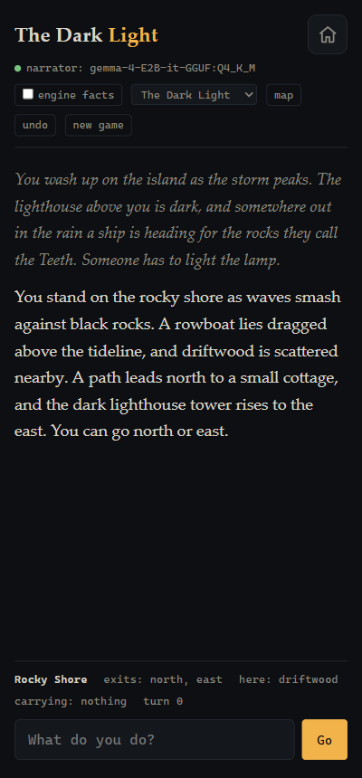
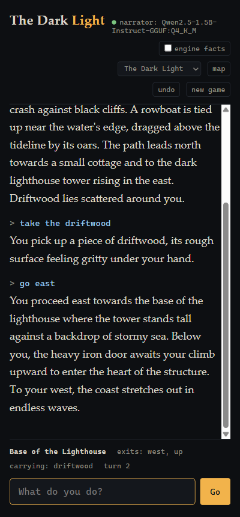
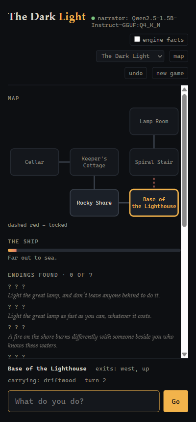

<p align="center"></p>

# The Dark Light: a tiny-LM text adventure engine

An [AirplaneMode](https://github.com/jessewolcott/airplanemode) app. It's a text-adventure
engine that plays in the browser. A small language model (served by llama.cpp) helps understand
players and narrate, and a deterministic engine keeps the game honest.

<p align="center">
  
  
  
</p>

<sub>Screenshots from the laptop dev stack; not yet tested on real hardware.</sub>

Games are data files. The engine, server, page, parser, narrator, solver and author tools are
shared, so **a new game is one JSON file** in `worlds/`. Three ship with it:

| Game | What it is | Endings |
|---|---|---|
| **The Dark Light** | A storm, a dark lighthouse, a ship heading for the rocks | 7 |
| **The Frozen Pass** | A blizzard, a cold mountain hut, a climber on the ridge | 4 |
| **The Fog Bell** | Fog on the marsh, children lost on the causeway, a bell with no rope | 4 |

## Making a new game

```
python cli.py new sunkenbell --title "The Sunken Bell"   # start from the template
python cli.py play sunkenbell                            # play it in the terminal
python cli.py check sunkenbell                           # validate + solve every possible game
python cli.py draft "<premise>" --id sunkenbell          # or let Claude draft it (dev machine only)
```

[docs/writing-a-game.md](docs/writing-a-game.md) covers all of the building blocks. VS Code
checks world files against [schemas/world.schema.json](schemas/world.schema.json) as you type.
Before a game ships, two automatic checks run:
- **Validator:** catches broken ids and missing fallbacks.
- **Solver:** plays every possible game. It proves every ending is reachable in time and finds
  dead ends, traps and the moves that close off an ending.

New games appear in the picker without code changes. On the box, mount a folder at `WORLDS_DIR`
and you can add games without a new image.

## Running it

**On the box:** the platform repo runs the released image at `/darklight/` and connects it to
the shared model. It isn't installed on the GL.iNet profile, which has no model. Whenever the
model is busy, loading or down, a keyword parser still understands plain English, and
narration is the engine's own text.

**On its own, for development:** `compose.yaml` runs the game with its own 0.5B model, the
author report at `/author`, and a `./games` folder for trying new worlds without rebuilding.

```
docker compose up -d --build        # first run downloads the model (~400 MB) -> http://localhost:8765
```

Use a different port with `PORT=9000`, or a different model with any GGUF on Hugging Face, for
example `MODEL=unsloth/gemma-4-E2B-it-GGUF:Q4_K_M`.

**Tests** (CI runs all of these):

```
python cli.py check --all-modes     # every world validates and solves, in every difficulty
python tests/test_endings.py        # scripted route to every ending
python tests/test_engine.py         # engine rules and fixed bugs
python tests/test_kit.py            # variants, modes, own verbs, solver, CLI, schema
pip install -r requirements.txt
python tests/test_app.py            # server, undo/resume, party, leaderboard, model guards (fake model)
python evals/parse_eval.py          # how well player text is understood (add --llm URL for the model)
```

**Releasing:** push a tag like `v0.3.0`. GitHub Actions runs the tests and publishes
`ghcr.io/jessewolcott/airplanemode-darklight:0.3.0` for arm64 and amd64. Then bump the pinned
tag in the platform repo's `compose.yaml`.

## For players

- **Free turns.** Actions that change the world take a turn. Looking, examining, failed attempts
  and repeated talk are free.
- **Difficulty.** Relaxed gives more time and nothing burns out. Hard has less time and no hints.
- **Layouts.** Some things start in a different place each game, and the text follows.
- **Undo** (typed or the button), up to 30 turns, including an ending.
- **Saving.** The browser saves after every turn, so a reload or server restart resumes. A
  **save code** carries a game to another device on the box.
- **Endings tracker** with a hint for each ending not found yet, and a **leaderboard**
  (fastest best ending per difficulty, most endings found). Scores are recorded by the server
  from the real game, not sent by the browser.
- **Party mode.** One game on a shared screen. Everyone on the box's Wi-Fi opens `/party`,
  suggests commands and votes, and each round the winner is played.
- **Read aloud and ambient sound,** both generated in the browser, so they work offline.

## How the work is split

A model this small can't be trusted with game state. It forgets, invents items and
contradicts itself. So it only gets narrow jobs, and every job has a deterministic guard:

| Job | Who | Guard |
|---|---|---|
| Rules, state, win condition | `engine.py` | the model never sees or edits state |
| Standard commands (`take key`, `n`, `take all`) | rule parser (`engine.parse_rule`) | exact; hands anything unclear on |
| Free-text intent ("head over to the lighthouse") | **model** classifies the verb | JSON-schema grammar limits it to valid verbs and exits; code matches nouns and places; unambiguous verb words override it |
| Free text with no model | keyword parser (`parsing.fallback_parse`) | fuzzy nouns, place aliases, keyword verbs; harmless when unsure (examines rather than uses) |
| Narration of story beats | **model** rewrites engine facts | rejected and replaced by plain facts if it's first person, repetitive, too long, drops an item or the direction, claims an action that didn't happen, or copies the examples |
| Dialogue | **model** voices the authored line | rejected unless it keeps exactly the same named things and places, avoids he/she, and stays close in length |
| Nudges when the player stalls | director (engine hint plus a turn counter) | hints come from the world file; off in hard mode |

Clock beats, ending text and timer messages are shown exactly as written. Tick **engine facts**
in the UI to see each turn's parse and the facts behind the narration.

## Measuring the model

- **`/api/stats`** counts, since start-up, how often narration and dialogue were used or thrown
  out, and which guard rejected them. `?samples=1` adds recent rejected outputs, plus player text
  nobody could parse.
- **`evals/parse_eval.py`** scores understanding against two test sets of player phrasings. A
  parse counts as right when it has the same effect in the game as the intended command.
  - The **tuned** set is the one the parser was improved against.
  - The **held-out** set has never been tuned against. It's the honest number, and today the
    no-model parser gets about 55% on it.

  The loop: collect unparsed text from `/api/stats?samples=1`, add it as cases, fix, and keep a
  fresh held-out set aside each round.

## Files

| Path | What it is |
|---|---|
| `worlds/*.json` | the games |
| `engine.py` | deterministic engine, rule parser, variants and modes, save/restore, world validation |
| `parsing.py` | noun/place matching, the model's command builder, the no-model parser |
| `solver.py` | exhaustive solver (used by `cli.py check`/`solve`, tests and `/author`) |
| `cli.py` | author tools: new, check, solve, play, map, draft |
| `app.py` | FastAPI server: sessions, model prompts and guards, party, leaderboard, save codes |
| `party.py`, `store.py` | party rounds; the small persistent store (`DATA_DIR`) |
| `static/` | the game page, the party page for phones, the author report |
| `docs/`, `schemas/`, `templates/` | authoring guide, JSON schema, starter world |
| `evals/` | parse test sets and scorer |
| `app.yaml` | this app's AirplaneMode manifest (port, path, memory, needs, env) |

## Known limits

- Narration can still add harmless flavour that contradicts details. The guards catch missing
  items, directions and false actions, not every invented detail.
- The no-model parser handles common phrasings, not everything (see the held-out score).
- Without `DATA_DIR`, the leaderboard and save codes reset when the container restarts.
- `cli.py draft` hasn't yet been run against the live API from this repo. Check its first
  output carefully.
